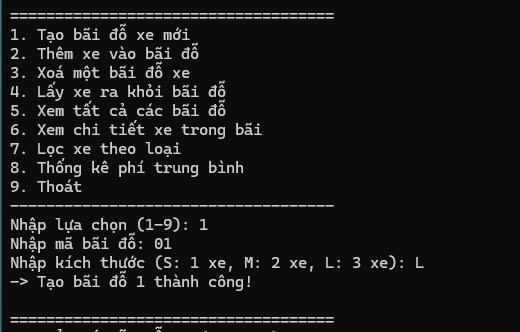
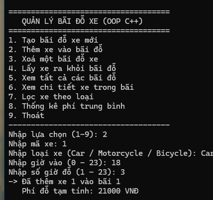
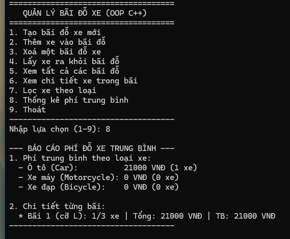

# Bài 01 - Quản lý bãi đỗ xe

## Cách chạy
- Mở file main.cpp bằng Dev-C++ rồi bấm F11 (Compile & Run)
- Hoặc biên dịch bằng lệnh:
```bash
g++ main.cpp -o main.exe
main.exe
```

## Mô tả ngắn
Chương trình quản lý tối đa 3 bãi đỗ xe theo hướng đối tượng (OOP):
- Lớp Xe: lưu thông tin xe và tự động tính phí đỗ
- Lớp BaiDoXe: quản lý xe trong bãi dùng biến đơn và cờ bool (không dùng mảng)
- Lớp GiaoDien: menu console 9 chức năng để thao tác

## Kết quả chạy thử



